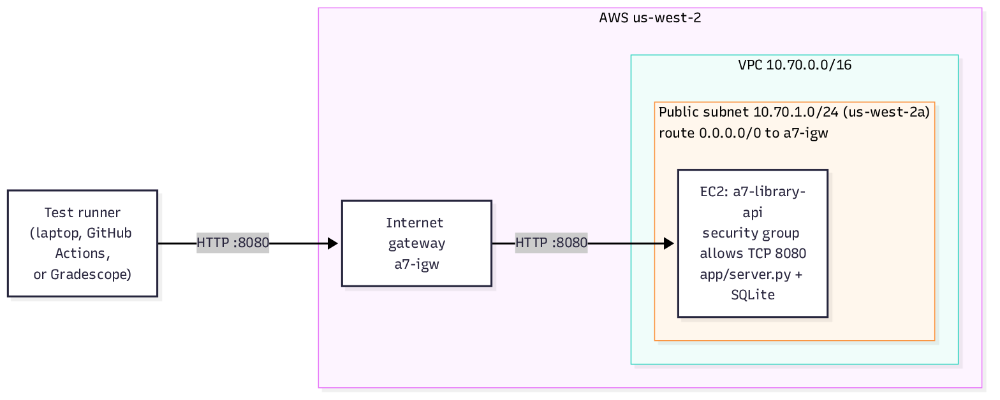

# Assignment 7: Library API on AWS with an Integration Test Suite

| | |
|---|---|
| **Course** | CSYE 6225 Network Structures and Cloud Computing, Fall 2026 |
| **Module** | Module 7: Continuous Integration and Testing |
| **Points** | 20 |
| **Region** | `us-west-2` (Oregon) |
| **Submission** | Gradescope, linked to this GitHub repository |

## Overview

Your team at Shadi.ai is launching a book-lending service for a chain of community libraries. Your job is to build the first version of its backend and prove that it works.

You will build two things:

1. **A REST API server** that implements the contract in [`docs/api-spec.md`](docs/api-spec.md).
2. **An integration test suite** in pytest that checks a server against that contract.

The AWS infrastructure is provided as Terraform in `terraform/`: a VPC, a public subnet, routing, a security group and an EC2 instance. You deploy your server with a few commands. [Appendix A](#appendix-a-infrastructure-reference) documents what it builds.

This server is the foundation for later assignments: you will add DNS, storage and monitoring to it. Build it cleanly.

## Learning Objectives

By completing this assignment you will:

- Implement a REST API from a written specification.
- Deploy an application to AWS with Terraform, `user_data` and `systemd`.
- Write integration tests that verify status codes, response bodies and business rules against a live server.
- Measure test quality: a good suite must pass against a correct server and fail against a buggy one.
- Use AI coding agents to help write tests, and review what they produce.

## Architecture



## What You Need to Do

| Step | Task | Where |
|---|---|---|
| 1 | Implement the API server | `app/server.py`: [Part 1](#part-1-the-api-server) |
| 2 | Deploy it to AWS with the provided Terraform | `terraform/`: [Part 2](#part-2-deploy-your-server-to-aws) |
| 3 | Write the integration test suite | `tests/integration/`: [Part 3](#part-3-the-integration-test-suite) |
| 4 | Commit, push and submit on Gradescope | [Submission](#submission) |

## Getting Started

1. Create your private repository from the template `neu-csye6225-sea/202609-assignment-07-template`: select **Use this template → Create a new repository**, choose **Private**, and leave **Include all branches** unchecked.
2. Clone it and look around:

```text
.
├── README.md                     this document
├── docs/api-spec.md              the API contract (read this first)
├── app/server.py                 starter server: only /healthcheck works
├── terraform/                    provided: VPC, subnet, routing, security group, EC2
│   ├── providers.tf
│   ├── variables.tf
│   ├── main.tf
│   ├── outputs.tf
│   └── user_data.sh.tftpl        installs app/server.py on the instance as a service
├── tests/integration/
│   ├── conftest.py               provided fixtures (base_url, auth_headers, make_book, ...)
│   ├── api_helpers.py            provided helpers (TIMEOUT, book_data, random_isbn)
│   ├── test_healthcheck.py       example test: no data needed
│   └── test_books_example.py     example test: creates its data with make_book
├── requirements-dev.txt          pytest + requests
└── .github/workflows/tests.yml   optional CI run of your tests
```
3. Set up a Python virtual environment for the tests. You need **Python 3.10 or later**. If you haven't used a virtual environment before, follow [Appendix B](#appendix-b-python-virtual-environments).

```bash
python3 -m venv venv
source venv/bin/activate
pip install -r requirements-dev.txt
```

---

## Part 1: The API Server

Implement every endpoint in [`docs/api-spec.md`](docs/api-spec.md). The spec is the contract: the autograder checks your deployed server against it, so read it carefully, including the Order of Checks section at the end.

**Summary of endpoints:**

| Method | Path | Auth | Purpose |
|---|---|---|---|
| `GET` | `/healthcheck` | No | Health check |
| `POST` | `/v1/login` | No | Exchange username and password for a bearer token |
| `GET` | `/v1/books` | Yes | List books, with pagination and filters |
| `POST` | `/v1/books` | Yes | Create a book |
| `GET` | `/v1/books/{id}` | Yes | Get one book |
| `PUT` | `/v1/books/{id}` | Yes | Replace a book's fields |
| `DELETE` | `/v1/books/{id}` | Yes | Delete a book |
| `POST` | `/v1/books/{id}/checkout` | Yes | Check a book out |
| `POST` | `/v1/books/{id}/return` | Yes | Return a book |

**Requirements:**

- Listen on port **8080**.
- Accept the grading account: username `grader`, password `Library-Fall2026`.
- Store books in **SQLite** (Python's built-in `sqlite3` module) at the path in the `DB_PATH` environment variable, so data survives a service restart.
- Use the **Python standard library only** (`http.server`, `json`, `sqlite3`, `secrets`, ...). The starter in `app/server.py` shows the pattern. Ubuntu 22.04 on the EC2 instance ships Python 3.10, so nothing needs to be installed there.

> **Tip:** `ThreadingHTTPServer` handles each request on its own thread. Open the SQLite connection with `check_same_thread=False` and wrap database access in a `threading.Lock()`.

### Run it locally

Start the server in one terminal:

```bash
python3 app/server.py
```

Then try it from a second terminal with `curl`. Until you implement an endpoint, the starter server answers `404`. The `-i` flag shows the status line and headers, which matter as much as the body.

**Health check** (no login needed):

```bash
BASE=http://127.0.0.1:8080

curl -i "$BASE/healthcheck"
# HTTP/1.1 200 OK
# {"status": "ok"}
```

**Log in** and save the token in a shell variable:

```bash
curl -s -X POST "$BASE/v1/login" \
  -H "Content-Type: application/json" \
  -d '{"username": "grader", "password": "Library-Fall2026"}'
# {"access_token": "3f9c...", "token_type": "Bearer"}

TOKEN=$(curl -s -X POST "$BASE/v1/login" \
  -H "Content-Type: application/json" \
  -d '{"username": "grader", "password": "Library-Fall2026"}' \
  | python3 -c 'import sys, json; print(json.load(sys.stdin)["access_token"])')
echo "$TOKEN"
```

**Create books** with `POST /v1/books`:

```bash
curl -i -X POST "$BASE/v1/books" \
  -H "Authorization: Bearer $TOKEN" \
  -H "Content-Type: application/json" \
  -d '{"title": "The Pragmatic Programmer", "author": "Andrew Hunt", "isbn": "9780135957059", "year": 2019}'
# HTTP/1.1 201 Created
# Location: /v1/books/1
# {"id": 1, "title": "The Pragmatic Programmer", "author": "Andrew Hunt", "isbn": "9780135957059", "year": 2019, "available": true}

curl -s -X POST "$BASE/v1/books" \
  -H "Authorization: Bearer $TOKEN" \
  -H "Content-Type: application/json" \
  -d '{"title": "Site Reliability Engineering", "author": "Betsy Beyer", "isbn": "9781491929124", "year": 2016}'
```

**List books** with `GET /v1/books` (`python3 -m json.tool` pretty-prints the response):

```bash
# All books, page 1
curl -s "$BASE/v1/books" -H "Authorization: Bearer $TOKEN" | python3 -m json.tool

# One book per page, second page
curl -s "$BASE/v1/books?page=2&page_size=1" -H "Authorization: Bearer $TOKEN" | python3 -m json.tool

# Filter by author (case-insensitive). -G with --data-urlencode encodes the space.
curl -s -G "$BASE/v1/books" -H "Authorization: Bearer $TOKEN" \
  --data-urlencode "author=andrew hunt" | python3 -m json.tool
```

**Get, check out and return one book:**

```bash
curl -s "$BASE/v1/books/1" -H "Authorization: Bearer $TOKEN"
curl -s -X POST "$BASE/v1/books/1/checkout" -H "Authorization: Bearer $TOKEN"   # "available": false
curl -s -X POST "$BASE/v1/books/1/return"   -H "Authorization: Bearer $TOKEN"   # "available": true
```

**Error cases.** `-w` prints the status code after the body:

```bash
curl -s -w "  HTTP %{http_code}\n" "$BASE/v1/books"                                   # 401: no token
curl -s -w "  HTTP %{http_code}\n" "$BASE/v1/books/999" -H "Authorization: Bearer $TOKEN"  # 404
curl -s -w "  HTTP %{http_code}\n" -X POST "$BASE/v1/books" \
  -H "Authorization: Bearer $TOKEN" -H "Content-Type: application/json" \
  -d '{"title": "Duplicate", "author": "Someone", "isbn": "9780135957059", "year": 2019}' # 409: ISBN in use
```

The server stores its data in `library.db` in the current directory, so books survive a restart. Delete the file to start over with an empty database.

---

## Part 2: Deploy Your Server to AWS

The Terraform in `terraform/` builds the network and the EC2 instance, and installs your `app/server.py` on it as a `systemd` service named `library-api`. You don't need to write or change any Terraform. [Appendix A](#appendix-a-infrastructure-reference) describes what it creates.

**Before you start**, check that:

- Terraform 1.6 or later is installed: `terraform version`.
- Your AWS credentials from earlier assignments work: `aws sts get-caller-identity`. If you use a named profile, `export AWS_PROFILE=<your-profile>` first.

**Deploy:**

```bash
cd terraform
terraform init       # first time only: downloads the AWS provider
terraform apply      # review the plan, then type "yes"
terraform output api_base_url
```

The instance takes a minute or two to boot and start the service. Then check it:

```bash
curl "$(terraform output -raw api_base_url)/healthcheck"
# {"status": "ok"}
```

All the `curl` commands from Part 1 work against AWS too: set `BASE="$(terraform output -raw api_base_url)"`.

**Updating your server.** When you change `app/server.py`, run `terraform apply` again. The provided Terraform **replaces** the instance with a fresh one running your new code. The new instance gets a **new public IP address**, and its database starts empty. Commit the updated `terraform/terraform.tfstate` after every apply.

**SSH (optional).** To log in to the instance, pass your IP address and an existing EC2 key pair:

```bash
terraform apply -var="ssh_cidr=$(curl -s https://checkip.amazonaws.com)/32" -var="key_name=my-key"
ssh -i ~/.ssh/my-key.pem ubuntu@"$(terraform output -raw instance_public_ip)"
sudo journalctl -u library-api      # the server's log
```

**Tearing it down.** `terraform destroy` deletes everything Terraform created (instance, network and security group) and stops all charges. Run it only **after your grade is posted**: the autograder needs your server running when you submit, and a regrade needs it running too. You can bring it back at any time with `terraform apply`. The new instance has a new IP address and an empty database.

> **Cost:** one `t3.micro` with its public IPv4 address and 8 GB disk costs roughly $0.40 a day (about $12 a month).

---

## Part 3: The Integration Test Suite

Write your tests with **pytest** in `tests/integration/`. They must check that a server follows `docs/api-spec.md`: status codes, response bodies, headers and business rules.

### Two separate grades

| Grade | What's tested | Against what |
|---|---|---|
| **Live API** | **Your server**, using the instructor's tests | Your EC2 server, at `api_base_url` in your committed state file |
| **Test Suite** | **Your tests**, using the instructor's servers | Servers the autograder starts inside Gradescope |

Your EC2 server plays no part in grading your tests, and your tests play no part in grading your server.

### How your tests are run

Your tests read their target from environment variables:

| Variable | Default | Meaning |
|---|---|---|
| `BASE_URL` | `http://127.0.0.1:8080` | Server URL, **without** `/v1` |
| `API_USERNAME` | `grader` | Login username |
| `API_PASSWORD` | `Library-Fall2026` | Login password |

The provided `conftest.py` and `api_helpers.py` already read these variables. **Never hardcode a host or IP address in a test**: the autograder points your suite at its own servers by setting `BASE_URL`.

Only `pytest` and `requests` are installed in the grading environment.

### Provided fixtures and helpers

The template gives you everything needed to log in and create test data, so **you don't need to write your own setup fixtures.**

**Fixtures** come from `conftest.py`. Use one by adding its name as a test function parameter:

| Fixture | What your test gets |
|---|---|
| `base_url` | The server URL from `BASE_URL`, for example `http://127.0.0.1:8080` |
| `auth_headers` | `{"Authorization": "Bearer <token>"}`, logged in as the grading account. Pass it as `headers=` |
| `make_book` | A function that creates a book and returns it as JSON. Books it creates are deleted after the test |
| `credentials` | `{"username": ..., "password": ...}`, for tests of `/v1/login` itself |
| `auth_token` | The raw access token string |
| `wait_for_service` | Runs automatically: waits up to 120 s for `/healthcheck` before any test starts |

**Helpers** come from `api_helpers.py`. Import them with `from api_helpers import TIMEOUT, book_data`:

| Helper | Use |
|---|---|
| `TIMEOUT` | Pass as `timeout=TIMEOUT` on every request |
| `book_data(**overrides)` | A valid request body with a unique author and ISBN. Override any field: `book_data(year=1200)` |
| `random_isbn()` | A random 13-digit ISBN |

### Creating test data with `make_book`

Every server the autograder starts begins with an **empty database**, and your tests can run in any order. So each test creates the data it needs, instead of relying on books that already exist or on other tests. Call `make_book()` once for each book the test needs:

```python
def test_get_book_returns_created_book(base_url, auth_headers, make_book):
    book = make_book()                         # creates a book; deleted after the test
    r = requests.get(f"{base_url}/v1/books/{book['id']}", headers=auth_headers, timeout=TIMEOUT)
    assert r.status_code == 200
    assert r.json() == book
```

This test is in the template as `tests/integration/test_books_example.py`. Some common patterns:

| You need | Call |
|---|---|
| One book | `book = make_book()` |
| A book with a specific field | `make_book(title="Dune", year=1965)` |
| Several books to test listing and pagination | `make_book(author=name)` three times, with a unique `name` such as `f"Pager {uuid.uuid4().hex[:8]}"`, then filter the list by that author |
| A checked-out book | `make_book()`, then `POST /v1/books/{id}/checkout` in the test |
| Two books, to test an ISBN conflict | `a = make_book()`, then send a `POST` or `PUT` that reuses `a["isbn"]` and check for `409` |

Filtering by a unique author keeps a list test's results limited to its own books, even when the server already has others.

Use `make_book` only to **set up** a test. To test `POST /v1/books` itself, including invalid bodies, send the request directly with `book_data()`, as in the examples below. `make_book` expects a `201` and stops the test if creation fails.

> **Before your `POST /v1/books` works,** every test that uses `make_book` errors with `setup: could not create book`. That's expected: implement create early, because most of your tests depend on it.

### How test quality is measured

The autograder has its own copy of the Library API: one **correct** version and **six buggy versions**, each with exactly one deliberate bug. It grades your suite in two steps:

1. **Against the correct server.** Your whole suite runs, and every test should pass. A test that fails here is wrong: it disagrees with the spec.
2. **Against each buggy server.** Your whole suite runs again, six times. You **catch** a bug when at least one test that passed in step 1 fails. Your tests are expected to fail here; that's the point.

**You don't do anything special for this.** No extra files, markers or code are needed, and you don't add bugs to your own server. Write ordinary pytest tests that check the spec **precisely**, and they will catch the bugs. Concretely:

- Assert **exact status codes**: `== 201`, not `< 300` or `!= 500`.
- Check **every field and its value**, not just that a response came back.
- Test the **error cases** and **rules** in the spec: 400, 401, 404 and 409 responses, and pagination metadata across more than one page.

The bugs come from three categories, two bugs in each:

| Category | What kind of bug |
|---|---|
| **Status codes** | An endpoint returns the wrong HTTP status code |
| **Response data** | A response is missing a field, or contains a wrong value |
| **Business rules** | A rule in the spec is not enforced |

After you submit, Gradescope shows which bugs your suite caught, with a one-line hint for each.

A weak test and a strong test for the same endpoint:

```python
# Weak: passes against almost any server, so it catches nothing
def test_create_book(base_url, auth_headers):
    r = requests.post(f"{base_url}/v1/books", json=book_data(), headers=auth_headers, timeout=TIMEOUT)
    assert r.status_code < 300

# Strong: checks the exact contract
def test_create_book(base_url, auth_headers):
    data = book_data()
    r = requests.post(f"{base_url}/v1/books", json=data, headers=auth_headers, timeout=TIMEOUT)
    assert r.status_code == 201
    book = r.json()
    assert r.headers["Location"].endswith(f"/v1/books/{book['id']}")
    assert book["isbn"] == data["isbn"]
    assert book["available"] is True
```

**Check your suite yourself before you submit.** Make a temporary bug in your **local** copy of `app/server.py`, for example return `200` instead of `201` from `POST /v1/books`. Restart the server and run your tests: at least one should fail. Then undo the change. If nothing fails, your suite has a gap. Don't deploy or commit the broken version.

### Requirements

- At least **20 test functions** that pass against a correct server. A parametrized test counts once, however many cases it has.
- Every request sets `timeout=` (use `TIMEOUT` from `api_helpers`). A hung request stops the whole run.
- Every test passes against a server that follows the spec.

### Running your tests

```bash
# Terminal 1: run your server locally
python3 app/server.py

# Terminal 2 (with your venv activated): run the suite against it
python3 -m pytest tests/integration -v

# Against your EC2 server
BASE_URL="$(terraform -chdir=terraform output -raw api_base_url)" python3 -m pytest tests/integration -v
```

**GitHub Actions (optional).** `.github/workflows/tests.yml` starts your server on a GitHub runner and runs the suite on every push. It is not graded, but it gives you fast feedback. If you wrote your server in another language, change the "Start the server" step.

### Using AI agents to write tests

AI coding agents (Claude Code, GitHub Copilot, Cursor, and others) are good at drafting tests. They are also good at writing tests that look thorough and check nothing. Use the workflow from the Module 7 slides:

1. **Give the agent the spec, not your code.** Point it at `docs/api-spec.md`. An agent that reads `app/server.py` writes tests that confirm what your server does, bugs included.
2. **Ask for a test plan first.** Have it list endpoint, scenario and expected status as a table. Review the plan and add what's missing (auth failures, invalid input, conflicts, pagination edges) before any code is written.
3. **Tell it the conventions:** use the fixtures in `conftest.py`, read config from environment variables, set `timeout=` on every request, and never hardcode hosts.
4. **Run the tests, then break your server on purpose**, as described above, to confirm the suite catches it.
5. **Review every generated test.** Watch for:
   - assertions that can't fail (`assert r is not None`)
   - only happy-path tests
   - mocked requests in an "integration" test
   - `@pytest.mark.skip`
   - assertions loosened to make a failing test pass

---

## Submission

1. Deploy your latest server with `terraform apply` and confirm that `curl "$(terraform -chdir=terraform output -raw api_base_url)/healthcheck"` works.
2. Commit everything, **including the state file**. The autograder reads your server's address from it. It is not ignored by `.gitignore`, but `-f` makes sure it's added:

```bash
git add -A
git add -f terraform/terraform.tfstate
git commit -m "Assignment 7 submission"
git push origin main
```

3. Go to **gradescope.com directly**, not through Canvas: GitHub sign-in doesn't work inside the Canvas frame. Open Assignment 7, choose **GitHub** as the submission method, and select this repository and the `main` branch.
4. **Keep your server running until grades are posted.** The Live API checks run when you submit. If the state file doesn't match a running server, those checks fail.
5. **After your grade is posted, run `terraform destroy`** in `terraform/` to stop AWS charges. Run `terraform apply` again when the next assignment needs the server.

You can resubmit as many times as you like before the deadline. Your last submission counts.

## Grading Rubric (20 Points)

| Part | Check | Points |
|---|---|---|
| **Live API** (your deployed server, checked against the spec) | Health check and authentication | 2 |
| | Book create, read, update and delete | 2 |
| | Validation and conflicts | 2 |
| | Checkout, return and list pagination | 2 |
| **Test Suite** (your tests, run inside Gradescope) | Tests pass against a correct server (scaled to at least 20 test cases) | 4 |
| | Bugs caught: 6 bugs, 1 point each | 6 |
| | At least 20 test functions (10–19 earns 1 point) | 2 |
| **Total** | | **20** |

Each Live API group awards partial credit for the share of its checks your server passes. Gradescope lists every failed check.

**Deductions:**

- **Score of 0:** AWS access keys (or any other credentials besides the published grading account) committed to the repository.
- **No Live API credit:** server deployed outside `us-west-2`, or in an AWS account other than the one you registered in Assignment 1.

## Troubleshooting

| Symptom | Things to check |
|---|---|
| `terraform/terraform.tfstate was not found` | Commit it with `git add -f terraform/terraform.tfstate`. |
| Live API: server did not answer `/healthcheck` | Is the instance running? Is the committed state current, with the same IP as `terraform output`? Wait a minute or two after `apply`. SSH in and run `systemctl status library-api` and `journalctl -u library-api`. |
| Changes to `server.py` don't show up on EC2 | Run `terraform apply` again. It replaces the instance and gives it a new IP: commit the new state. |
| "These tests fail against a server that follows the spec" | The test, or its assumption about the spec, is wrong. Re-read that part of `docs/api-spec.md`. |
| `pytest did not finish` | Add `timeout=` to every request. Don't `sleep()` in tests. |
| A test passes alone but fails in the suite | Tests are sharing data. Create fresh data in each test with `make_book`. |
| `setup: could not create book` | `make_book` got something other than `201` from `POST /v1/books`. Check your server's create endpoint first. |
| `ModuleNotFoundError: No module named 'pytest'` | Your virtual environment isn't active. Run `source venv/bin/activate` (see Appendix B). |

---

## Appendix A: Infrastructure Reference

The provided Terraform in `terraform/` creates the resources below. It's here so you know what your server runs on. Later assignments build on this network, so don't change it.

| Resource | Configuration |
|---|---|
| **VPC** | CIDR `10.70.0.0/16`; `enable_dns_support = true` and `enable_dns_hostnames = true`; tag `Name = "a7-vpc"` |
| **Public subnet** | CIDR `10.70.1.0/24`; availability zone `us-west-2a`; `map_public_ip_on_launch = true`; tag `Name = "a7-public-subnet"` |
| **Internet gateway** | Attached to the VPC; tag `Name = "a7-igw"` |
| **Route table** | Route `0.0.0.0/0` to the internet gateway, associated with the public subnet; tag `Name = "a7-public-rt"` |
| **Security group** | In the VPC. Inbound TCP **8080** from `0.0.0.0/0`. SSH (22) only if you pass `ssh_cidr`, and only from that address. All outbound traffic allowed. Tag `Name = "a7-api-sg"` |
| **EC2 instance** | Ubuntu 22.04 LTS; `t3.micro`; in the public subnet with a public IP; uses the security group; requires IMDSv2; tag `Name = "a7-library-api"` |
| **Outputs** | `api_base_url` (`http://<public IP>:8080`), `instance_public_ip`, `instance_id` |

Every resource is also tagged `Project = "csye6225"` and `Assignment = "a7"`.

| File | Contents |
|---|---|
| `providers.tf` | Terraform and AWS provider versions; region; default tags |
| `variables.tf` | `region` (must be `us-west-2`), `instance_type`, and optional `ssh_cidr` and `key_name` for SSH |
| `main.tf` | Ubuntu AMI lookup, VPC, subnet, internet gateway, route table, security group and rules, EC2 instance |
| `outputs.tf` | `api_base_url`, `instance_public_ip`, `instance_id` |
| `user_data.sh.tftpl` | First-boot script: copies `app/server.py` to `/opt/library-api/`, stores the database in `/var/lib/library-api/library.db`, and runs the server as the `library-api` systemd service on port 8080 |

How the server gets onto the instance: `main.tf` passes `user_data.sh.tftpl` to the instance through `templatefile()`, with `app/server.py` gzipped and base64-encoded inside it to stay under the 16 KB `user_data` limit. Because `user_data_replace_on_change = true`, any change to `server.py` changes the `user_data`, so Terraform replaces the instance on the next `apply`.

---

## Appendix B: Python Virtual Environments

A **virtual environment** ("venv") is a private copy of Python for one project. Packages you install with `pip` go into the project's `venv/` directory instead of your system Python, so projects don't interfere with each other. This assignment's tests need `pytest` and `requests`, which you install into a venv.

Your **server** uses only the standard library, so it doesn't need the venv. Running it from inside the venv is fine too.

### 1. Check your Python version

You need **Python 3.10 or later**:

```bash
python3 --version
# Python 3.10.12   (any 3.10 or higher is fine)
```

If Python is missing or older than 3.10:

| System | Install |
|---|---|
| **Ubuntu / Debian** | `sudo apt update && sudo apt install -y python3 python3-venv python3-pip` |
| **macOS** | `brew install python@3.12`, or the installer from [python.org](https://www.python.org/downloads/) |
| **Windows** | Use **WSL** (Ubuntu), which matches the Linux environment used in this course, and follow the Ubuntu line. Or install from [python.org](https://www.python.org/downloads/) and use the Windows commands below. |

On Ubuntu, `python3 -m venv` fails with "ensurepip is not available" until the `python3-venv` package is installed.

### 2. Create the venv (once per repository)

From the root of your repository:

```bash
python3 -m venv venv
```

This creates a `venv/` directory. It is listed in `.gitignore`: **never commit it**.

### 3. Activate it (every new terminal)

```bash
source venv/bin/activate          # Linux, macOS, WSL
```

```powershell
venv\Scripts\Activate.ps1         # Windows PowerShell
venv\Scripts\activate.bat         # Windows Command Prompt
```

Your prompt now starts with `(venv)`. While it's active, `python` and `pip` refer to the venv's copies.

### 4. Install the test dependencies

```bash
pip install -r requirements-dev.txt
```

### 5. Check that it worked

```bash
which python                      # .../venv/bin/python
python -m pytest --version        # pytest 8.x
```

### Everyday use

| Task | Command |
|---|---|
| Start working in a new terminal | `source venv/bin/activate` |
| Run the tests | `python -m pytest tests/integration -v` |
| Stop using the venv | `deactivate` |
| Start over if it breaks | `deactivate; rm -rf venv`, then repeat steps 2–4 |

**VS Code:** open the Command Palette, choose **Python: Select Interpreter**, and pick the one under `./venv`. The editor and its built-in terminal then use the venv automatically.
